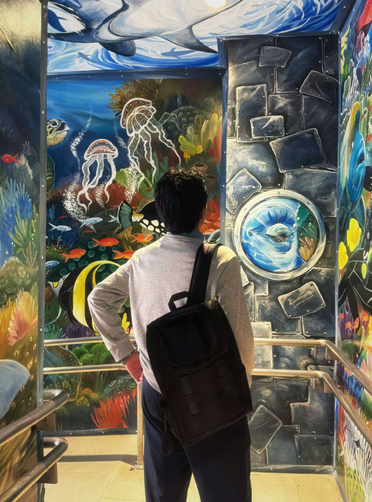
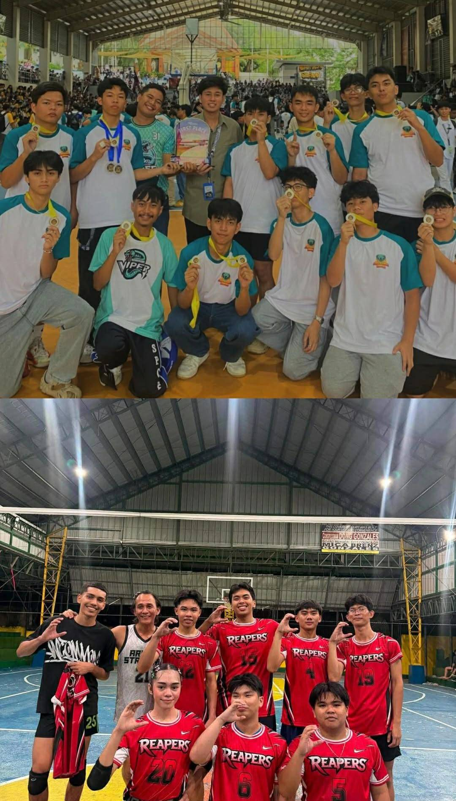
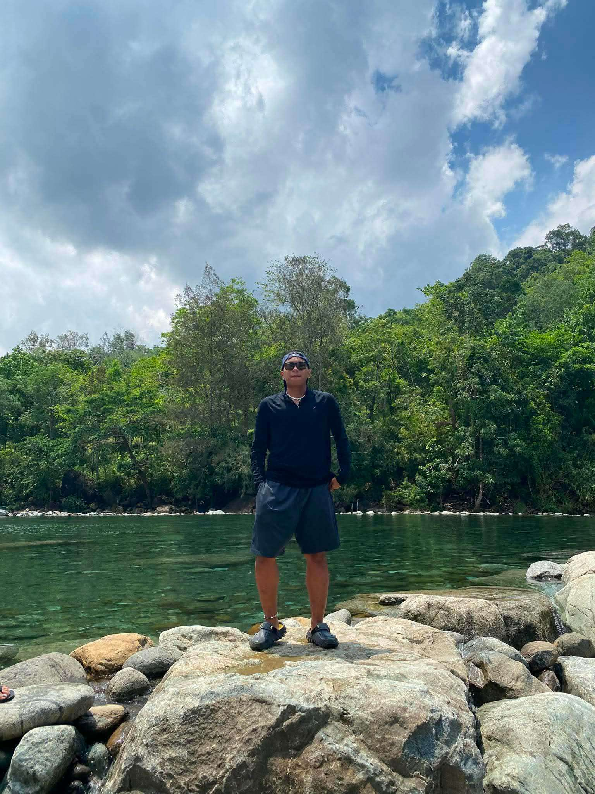
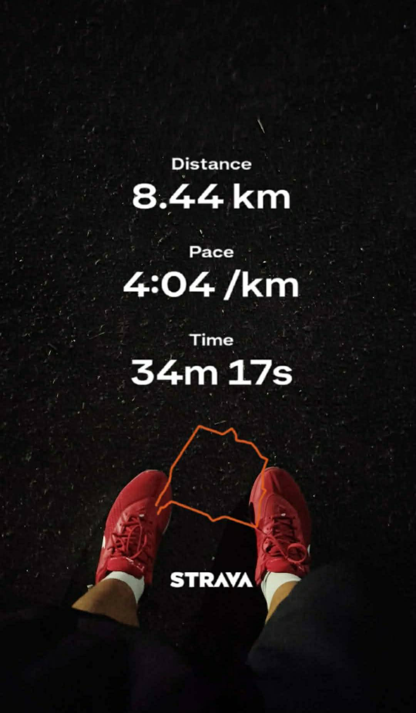
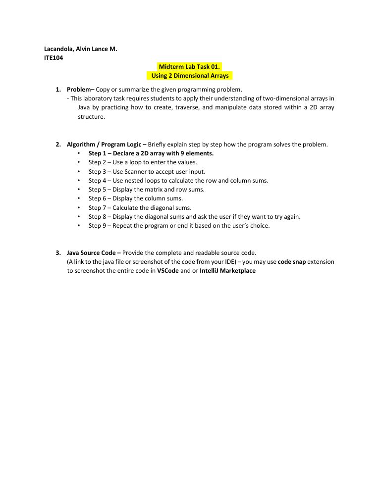
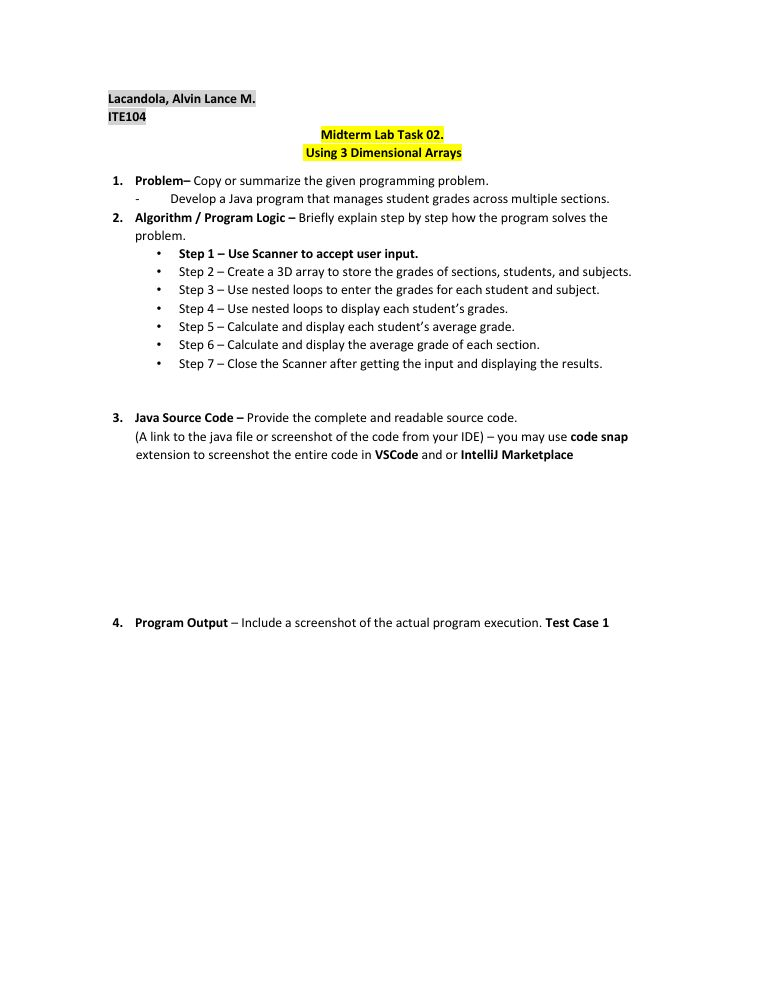

<!DOCTYPE html>
<html lang="en">
<head>
<meta charset="UTF-8">
<meta name="viewport" content="width=device-width, initial-scale=1, viewport-fit=cover">
<title>Alvin | My Portfolio</title>

</head>
<body>
<nav><a href="#home">Home</a><a href="#about">About</a><a href="#myself">Myself</a><a href="#midterm">Midterm</a><a href="#final">Final</a></nav>

<h1>BASTA MANYAMAN</h1>
<h2>Welcome to My Portfolio!</h2>

I’m Alvin, a BS Information Technology student at NU Clark. Explore my learning journey, laboratory tasks, and the things I love outside the screen.

<a class="btn" href="#midterm">View My Work</a>

Alvin | BSIT Student

<section id="about">
<h2>About Me</h2>

I’m a student who enjoys exploring new things, learning different skills, and turning ideas into something meaningful. I believe that every experience is an opportunity to grow and improve.

pogihandsomecoolgwapo

</section>

<section id="myself">
<h2>Myself</h2>

<h3>🍳 Cooking</h3>
I enjoy cooking, experimenting with recipes, and trying different cuisines.

<h3>🏐 Volleyball</h3>
I enjoy the competition, teamwork, and constantly improving my volleyball skills.

<h3>🏔️ Hiking</h3>
Exploring nature, discovering new places, and enjoying the outdoors.

<h3>🏃 Running</h3>
Staying active, challenging myself, and getting better every day.

</section>

<section id="midterm">
<h2>Midterm Laboratory</h2>

<h3>Lab Task 1: Using 2 Dimensional Arrays</h3><a class="pdfbtn" href="labs/midterm-lab1.pdf">📄 View Whole PDF →</a>

<h3>Lab Task 2: Using 3 Dimensional Arrays</h3><a class="pdfbtn" href="labs/midterm-lab2.pdf">📄 View Whole PDF →</a>

</section>

<section id="final">
<h2>Final Laboratory</h2>

<h3>Final Lab 1</h3>
nyaman

<h3>Final Lab 2</h3>
nyaman

</section>

<footer>© 2026 Alvin | Do your best, and God will do the rest. 🙏</footer>
</body>
</html>
